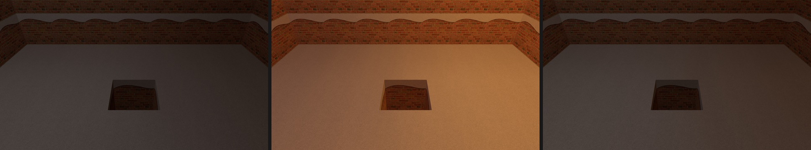
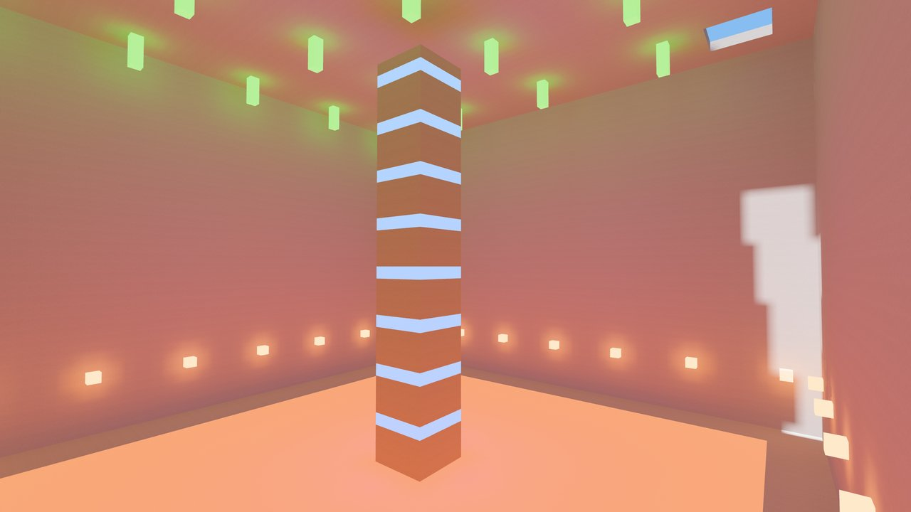

# bevy_voxel_gi

[](https://crates.io/crates/bevy_voxel_gi)
[](https://docs.rs/bevy_voxel_gi)
[](https://github.com/nathanaelneveux/global-illumination/actions/workflows/ci.yml)


Put a lamp on the floor of a stone room. The lamp glows, then the stone
takes on its color. Open a window and sunlight spills across the floor.
The light follows your edits as you build and dig.

`bevy_voxel_gi` adds real-time diffuse global illumination to axis-aligned
voxel worlds in Bevy 0.20. It traces light with ordinary GPU compute, so it
needs no ray-tracing hardware.

## Getting started

- **See the light change.** [Run the examples](#try-the-examples) or
  [explore the lab](#try-the-lab).
- **Light your own voxel engine.** [Core quick start](crates/bevy_voxel_gi/README.md#quick-start)
- **Add GI to `bevy_voxel_world`.** [Connector quick start](crates/bevy_voxel_gi_bvw/README.md#quick-start)
- **Tune lighting live.** [Debug plugin](crates/bevy_voxel_gi_debug/README.md)

## Try the examples

You'll need [Rust 1.97.1 or newer](https://rustup.rs) and
[Bevy's platform dependencies](https://bevy.org/learn/quick-start/getting-started/setup/#installing-os-dependencies).
Start with the stone room.

```sh
git clone https://github.com/nathanaelneveux/global-illumination
cd global-illumination
cargo run --locked -p bevy_voxel_gi --example minimal
```

Look past the orange lamp to the stone around it. That's where you can
see the light that bounced. Now try the room with a window that opens
and closes every two seconds. Watch the patch of sun on the floor.

```sh
cargo run --locked -p bevy_voxel_gi --example edits
```

## How it works

The camera tells GI which voxel faces it can see. GI traces those faces,
keeps nearby lighting in a world cache when you look away, and lights
small distant faces in screen space. When you edit a block, nearby faces
discount their old light in proportion to the change and sample again.
[Architecture](docs/architecture.md)



*The room before placing an off-screen lamp, 0.2 seconds after placing it,
and 0.3 seconds after removing it. Captured with the lab's offscreen
`response` profile on an Apple M4.*

## Platforms

Voxel GI runs on native Metal, Vulkan and DX12. It can't run on WebGPU,
which allows too few storage buffers. We've tested it on an Apple M4
(Metal) and an AMD RX 7900 XT (Vulkan and DX12). On Windows, start with
Vulkan: DX12 needs the DXC shader compiler. See
[platform setup](crates/bevy_voxel_gi/README.md#platforms), and if you
have another GPU, the [GPU testing guide](docs/testing-other-gpus.md).

## Try the lab

Run `cargo run --locked` from the checkout. Follow the pale path to the
right of the house and enter the cave near **(20, 11, −18)**.

Aim at stone and press **E** to place a lamp. Watch the wall beside it
while you tap **F4** to turn indirect light off and back on. The lamp
stays bright while its light on the stone comes and goes. Remove it with
**left click** to see how the room responds to an edit.



To jump straight to a test scene:

```sh
VOXEL_GI_SCENE=cave cargo run --locked
VOXEL_GI_SCENE=canyon cargo run --locked
```

In PowerShell, set `$env:VOXEL_GI_SCENE = "cave"` first instead.

In the [daylight canyon](docs/images/canyon.jpg), look for warm light
bouncing off the sunlit rim into the shade.

<details>
<summary>All lab controls</summary>

| Input | Action |
| --- | --- |
| WASD / mouse | Move / look |
| Space / Ctrl / Shift | Jump / crouch / sprint |
| Space twice | Toggle creative flight: WASD, Space up, Ctrl down, Shift 3× faster |
| Left / right click | Remove / place a voxel |
| E | Place a warm emitting voxel at the aimed-at face |
| B | Remove a radius-5 sphere at the aimed-at voxel |
| F3 | Mesh debug overlay |
| F4 | Toggle indirect GI |
| F5 | Flat faces / corner interpolation |
| F6 | Cycle diagnostic views (irradiance, tier coverage, indirect, sun, exact sun, face validity) |
| F7 | GI's corner sun / Bevy's per-pixel sun |
| Esc | Release the cursor and open the inspector and HUD buttons |

</details>

Press **Esc**, then **Lighting controls** to tune the look or choose a
preset. **Copy** and **Paste** move settings as RON. Launch with saved
settings using `VOXEL_GI_SETTINGS=path.ron cargo run --locked`. See
[the HUD guide](crates/bevy_voxel_gi_debug/README.md) for the readings.

## Documentation

- **Integrate and tune** with the [core guide](crates/bevy_voxel_gi/README.md)
  and [API reference](https://docs.rs/bevy_voxel_gi).
- **Understand the renderer** in the [architecture](docs/architecture.md) and
  [surface cache study](docs/surface-cache.md). See
  [research and decisions](docs/research.md) for the papers and tradeoffs.
- **Measure a change** using the [validation guide](docs/validation.md).
  The [historical studies](docs/history/README.md) record the measurements
  behind the defaults.
- **Check compatibility and known limitations** in the
  [changelog](CHANGELOG.md#known-limitations).

## Contributing

Bug reports and GPU reports are welcome as GitHub issues. The
[GPU testing guide](docs/testing-other-gpus.md) lists what to include.

For a pull request, explain the problem and your change. Run formatting,
Clippy and the checks that fit the diff; the
[validation guide](docs/validation.md#choose-the-relevant-check) says which.
Performance and lighting changes need before-and-after evidence.
[AGENTS.md](AGENTS.md) records our workflow, and the
[release guide](docs/releasing.md) covers publishing.

## License

The crates are `MIT OR Apache-2.0` ([MIT](LICENSE-MIT.txt),
[Apache](LICENSE-Apache-2.0.txt)); `bevy_voxel_gi` keeps the MIT notice of the
`sobol_burley` code it adapts. The lab app (the root package) is
`CC0-1.0 OR MIT OR Apache-2.0` ([CC0](LICENSE-CC0-1.0.txt)).
