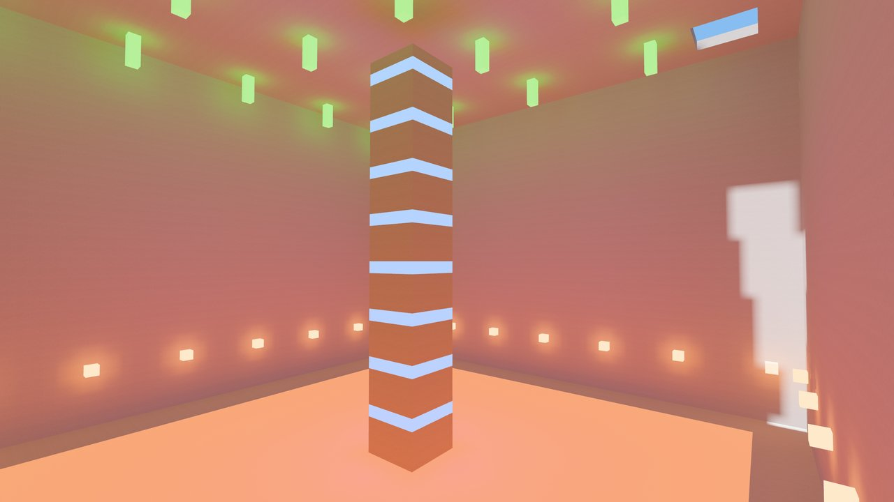
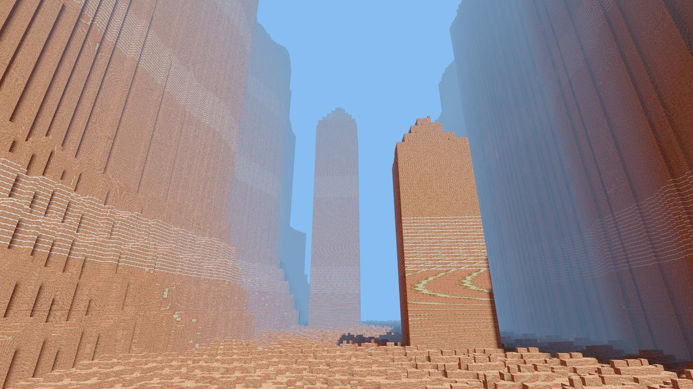
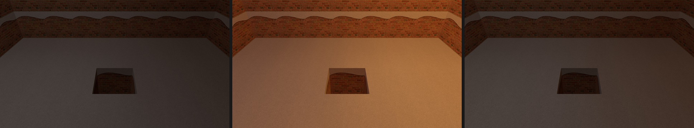

# bevy_voxel_gi

[](https://crates.io/crates/bevy_voxel_gi)
[](https://docs.rs/bevy_voxel_gi)
[](https://github.com/nathanaelneveux/global-illumination/actions/workflows/ci.yml)


Real-time diffuse global illumination for axis-aligned voxel worlds in
[Bevy](https://bevyengine.org) 0.19: sunlight, sky, emissive voxels and
multi-bounce indirect light, traced on the GPU against the voxels themselves.





*A glowing block appears in a closed room, just out of view: 0.2 s later its
bounced light fills the room, and 0.3 s after it's removed the light is gone,
with no ghost light lingering. Captured headlessly by the lab's `response`
profile on an Apple M4.*

## How it works

- **No ray-tracing hardware.** Compute shaders trace the voxels themselves,
  so it runs on Apple Silicon and integrated GPUs. On an Apple M4 at 1440p,
  finding and presenting visible faces costs about 4 ms a frame, and tracing
  fills a GPU time share you set (20% of the frame by default).
- **Visible faces are traced every frame.** They're discovered from each
  camera's depth and normal prepass and traced within that share, with
  histories that follow each face as the camera moves.
- **Light persists off screen.** A world cache keeps faces within 64 voxels
  of the cameras lit off screen and trades history with visible faces, so
  turning around, revisiting and editing out of view stay warm. A ray that reaches a cached face ends there
  with its stored light, so bounces add up over time
  ([surface cache](https://github.com/nathanaelneveux/global-illumination/blob/HEAD/docs/surface-cache.md)).
- **Distance costs what the screen shows.** Faces small on screen (a voxel
  under 8 pixels across) are lit per pixel instead, so distant terrain costs
  follow the screen, not the world.
- **Edits relight what they affect.** The host tells GI which voxels
  changed, and it drops history near each change in proportion to its
  measured effect: digging a tunnel relights the tunnel without resetting the
  rest of the scene, and nothing is guessed from frame-to-frame differences.
- **Emissive blocks are lights.** A light tree chooses which of many emitters
  to sample.
- **Noise is pooled, not smeared.** Presentation pools coplanar neighbours by
  their measured noise until each face has enough samples of its own, then
  blends over time. Sunlight is sampled at shared voxel corners.
- **Your engine, your meshes.** GI reads voxels through a trait and lights your
  materials. It never meshes or owns the world, accepts coarse level-of-detail
  pages, and works under ray-traced renderers as well as meshes.

## Quick start

Add the core crate to a Bevy 0.19 application:

```toml
[dependencies]
bevy = "0.19"
bevy_voxel_gi = "0.1"
```

| Bevy | bevy_voxel_gi |
| --- | --- |
| 0.19 | 0.1 |

Each release targets one Bevy minor version: host materials override Bevy
PBR internals that change between Bevy releases.

`bevy_voxel_gi_bvw` connects `bevy_voxel_world` for you; `bevy_voxel_gi_debug`
adds a HUD and tuning panel. Both share the core's version.

A host does four things: describe how each block reflects and emits light,
hand GI a read-only view of its voxels, say which 32³ pages exist, and draw
its meshes with a GI-lit material. A complete flat world:

```rust,no_run
use bevy::prelude::*;
use bevy_voxel_gi::{
    MaterialPalette, MaterialTransport, PageSample, VoxelGiInput, VoxelGiMaterialData,
    VoxelGiPlugin, VoxelGiSource, VoxelGiStandardMaterial, VoxelGiStandardMaterialPlugin,
    VoxelMaterialTransportTable, VoxelSource, dense_page, standard_material,
};
use std::sync::Arc;

fn main() {
    App::new()
        // GI itself, and Bevy's `StandardMaterial` lit by GI.
        .add_plugins((DefaultPlugins, VoxelGiPlugin, VoxelGiStandardMaterialPlugin))
        .add_systems(Startup, setup)
        .run();
}

/// GI reads your world through a `VoxelSource`, one 32³ page at a time, on
/// worker threads: give it an immutable snapshot of your voxel data.
struct Flat {
    stone: u8,
}

impl VoxelSource for Flat {
    // `resample` asks for authoritative data after a change GI wasn't told
    // the details of; a source with one representation can ignore it.
    fn sample_page(&self, page: IVec3, _resample: bool) -> PageSample {
        // A transport material per voxel; `None` is air.
        dense_page(page, |voxel| (voxel.y < 4).then_some(self.stone))
    }
}

fn setup(
    mut commands: Commands,
    mut palette_table: ResMut<VoxelMaterialTransportTable>,
    mut source: ResMut<VoxelGiSource>,
    mut input: ResMut<VoxelGiInput>,
    gi_bindings: Res<VoxelGiMaterialData>,
    mut meshes: ResMut<Assets<Mesh>>,
    mut materials: ResMut<Assets<VoxelGiStandardMaterial>>,
) {
    // 1. Optics. The palette gives each distinct optics a transport ID
    //    (blocks with identical optics share one); GI reads the table.
    let mut palette = MaterialPalette::new();
    let stone = MaterialTransport {
        diffuse: Vec3::splat(0.6),
        emission: Vec3::ZERO, // a lamp would set this
    };
    let stone = palette.insert("stone", stone).unwrap() as u8;
    *palette_table = palette.table().clone();

    // 2. Voxels: the source GI samples from.
    source.0 = Some(Arc::new(Flat { stone }));

    // 3. Pages: the 32³ pages GI knows about are its whole world. Tell it
    //    as they load and unload (`page_unloaded`); report edits with
    //    `edit_voxel` so it relights only what changed.
    for x in -2..2 {
        for z in -2..2 {
            input.page_loaded(IVec3::new(x, 0, z));
        }
    }

    // 4. Meshes. GI lights a fragment from the voxel face it lies on, so
    //    meshes sit on voxel faces: here, the top of the stone at y = 4.
    //    `gi_bindings` carries GI's GPU data; the plugin keeps it current.
    let ground = materials.add(standard_material(
        StandardMaterial {
            base_color: Color::srgb(0.6, 0.6, 0.6),
            ..default()
        },
        &gi_bindings,
    ));
    commands.spawn((
        Mesh3d(meshes.add(Plane3d::default().mesh().size(128.0, 128.0))),
        MeshMaterial3d(ground),
        Transform::from_xyz(0.0, 4.0, 0.0),
    ));

    // Directional lights become GI's suns; GI traces their visibility
    // itself, so turn their shadow maps off.
    commands.spawn((
        DirectionalLight {
            illuminance: 8_000.0,
            shadow_maps_enabled: false,
            ..default()
        },
        Transform::default().looking_to(Vec3::new(-0.4, -0.8, -0.5), Vec3::Y),
    ));
    // Each camera gets the depth and normal prepasses GI needs.
    commands.spawn((
        Camera3d::default(),
        Transform::from_xyz(20.0, 12.0, 20.0).looking_at(Vec3::ZERO, Vec3::Y),
    ));
}
```

[`examples/minimal.rs`](https://github.com/nathanaelneveux/global-illumination/blob/HEAD/crates/bevy_voxel_gi/examples/minimal.rs)
is the same shape with a lit room and a glowing lamp, and
[`examples/edits.rs`](https://github.com/nathanaelneveux/global-illumination/blob/HEAD/crates/bevy_voxel_gi/examples/edits.rs)
opens and closes a window in its wall with `edit_voxel`. From a checkout:

```sh
cargo run -p bevy_voxel_gi --example minimal
cargo run -p bevy_voxel_gi --example edits
```

More on each step:

- **Materials.** With integer block IDs, build a dense lookup from the
  palette once, with `optics_id(MaterialTransport::default())` for blocks
  you haven't registered. Transparent blocks are `AIR` to GI
  (`palette.insert_transparent`). A source that reports your own IDs
  unchanged (as `bevy_voxel_gi_bvw` does) sets the table at those IDs
  instead.
- **Levels of detail.** A page can be coarse: `PageSample::coarse(stride, ..)`
  holds one material per 2³, 4³ or 8³ block. Draw it as the same blocks.
- **Sky and other lights.** `VoxelGiEnvironment` sets the sky.
  `VoxelGiEmitter` adds a light that has no Bevy counterpart.
- **Readiness.** `VoxelGiStats::geometry_pending` says whether declared pages
  have reached the GPU yet.

## Lighting your own material

Wrap your material as `ExtendedMaterial<YourMaterial, VoxelGiBindings>` and
add `VoxelGiMaterialPlugin::<_>::extended()`, which keeps GI's bindings
current. GI uses bindings 104 and 106-111 of the material bind group; keep
them free. Two Bevy details apply to every `ExtendedMaterial`:

- It takes its prepass and shadow switches from the extension (both on),
  not from your material: add `NotShadowCaster` to entities that must not
  cast shadows.
- It takes its render method from your material. GI presents in the forward
  fragment shader, so render forward (`OpaqueRendererMethod::Forward` for a
  `StandardMaterial` base); a deferred material runs Bevy's deferred shader
  without GI.

In its fragment shader, import GI's presentation functions:

```wgsl
#import bevy_voxel_gi::presentation::{indirect_light, sunlight, emission}

// Indirect light reflects off the surface's albedo; emission adds as is.
let gi = indirect_light(in.position.xy, in.world_position.xyz, normal);
color += albedo * gi.light + emission(in.world_position.xyz, normal);
// `sunlight` replaces Bevy's sun: GI's traced visibility, in transport
// units (multiply by albedo * 10,000 / pi).
```

`shaders/voxel_gi_standard.wgsl` is the complete version. A ray-traced host
can pass any hit's position and normal, but must also write compatible depth
and normal prepasses, which GI reads to find visible faces.
`face_in_geometry` says whether GI covers a face; light the others yourself
(`sun_count`, `sun_direction` and `sun_color` give GI's suns).

## Platforms

Native GPUs only (Metal, Vulkan, DX12). Not WebGPU: the view tier uses more
storage buffers per stage than WebGPU allows.

On Windows both backends work: all GPU tests pass on an AMD RX 7900 XT.
Vulkan needs no setup, and wgpu picked it by default there. DX12 needs the
DXC shader compiler, because FXC, wgpu's fallback when DXC is unavailable,
rejects GI's compute shaders. On that machine DX12 also reached GI's first
frame in 6.4 s with a warm shader cache, against 0.3 s on Vulkan; frame
times haven't been compared.

### DX12

Either enable Bevy's `statically-linked-dxc` feature, or ship
`dxcompiler.dll` and `dxil.dll` next to your executable and select them
explicitly. Bevy's automatic detection looks only in the working directory,
so a game launched from anywhere else would fall back to FXC.

```rust,no_run
use bevy::prelude::*;
use bevy::render::{
    RenderPlugin,
    settings::{Dx12Compiler, WgpuSettings},
};

let dxc = std::env::current_exe().unwrap().with_file_name("dxcompiler.dll");
App::new().add_plugins(DefaultPlugins.set(RenderPlugin {
    render_creation: WgpuSettings {
        dx12_shader_compiler: Dx12Compiler::DynamicDxc {
            dxc_path: dxc.to_string_lossy().into_owned(),
        },
        ..default()
    }
    .into(),
    ..default()
}));
```

## Tuning

`VoxelGiSettings` (RON-loadable, `VoxelGiQuality` presets):

- `gpu_time_share`: the GPU time GI's tracing may use.
- `cache_radius`: the world cache's radius in voxels (64; 0 disables it).
- `far_tier.voxel_pixels`: below this projected voxel size (8 px, about 220
  voxels at 1440p) faces are lit per pixel; 0 disables the far tier.
- `view_receivers`: the cap on lit faces per camera.

`VoxelGiStats` and `ViewReceipts` report work and GPU time; `geometry_pending`
tells you when declared pages have reached the GPU.

## Performance

Measured on an Apple M4 (10-core GPU) at 2560×1440. The view tier's fixed
GPU work per frame (finding visible faces, presentation and the far tier) is
about 4 ms on open streaming terrain and 1.6 ms in a closed cave. Its tracing
adapts to fill `gpu_time_share` (20% of the frame by default), about 3.5 ms
here, and the world cache's work has the same cap. These are GPU stage
timings, not frame rates. Windows validation on an AMD RX 7900 XT covers
Vulkan and DX12 with DXC; its measurements and settings are recorded in the
[Windows test report](https://github.com/nathanaelneveux/global-illumination/blob/HEAD/docs/history/windows-first-run.md).

## Limitations

- Opaque diffuse transport only: transparent blocks are `AIR` to GI (no
  colored transmission), and there is no specular GI.
- In motion, the far tier's indirect light flickers somewhat more than the
  per-face tiers'.
- Each edit or sun change costs some re-convergence near it; lighting
  response depends on retained history, scene complexity and available work.
- Geometry is built asynchronously from all declared pages. Large streaming
  worlds can take seconds to publish changes; newly meshed or remeshed faces
  can remain dark until the matching GI geometry arrives.

## Credits

- [NAADF: Globally Illuminated Voxel Worlds Accelerated with Nested
  Axis-Aligned Distance Fields](https://www.cg.tuwien.ac.at/research/publications/2026/ulschmid-2026-naadf/)
  ([code](https://github.com/cg-tuwien/NAADF)): the acceleration structure
  and the per-pixel lighting of small faces. This is an independent compute
  implementation, not a port of NAADF's renderer.
- [vxray](https://github.com/Nelarius/vxray) and its
  [development log](https://nelari.us/post/voxel-ray-tracing/): voxel
  traversal.
- [sobol_burley](https://github.com/cessen/sobol_burley) by Nathan Vegdahl:
  the hash-based Owen scramble in the path sampler (MIT,
  `licenses/sobol_burley-MIT.txt`).
- [PBRT](https://pbr-book.org/4ed/Shapes/Managing_Rounding_Error#SpawnRayTo):
  ray spawning.

## License

Licensed under MIT or Apache-2.0, at your option. The adapted `sobol_burley`
code keeps its MIT notice.
