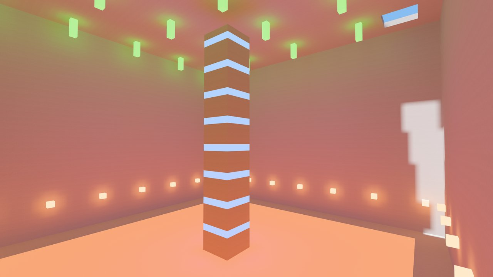
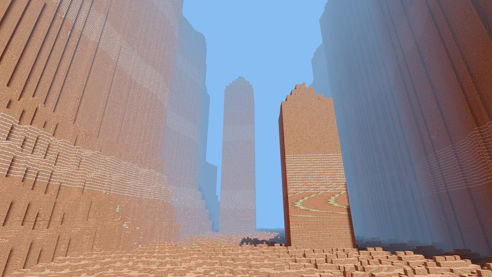

# voxel_gi

Real-time diffuse global illumination for axis-aligned voxel worlds in
[Bevy](https://bevyengine.org) 0.19: sunlight, sky, emissive voxels and
multi-bounce indirect light, traced on the GPU against the voxels themselves.

- **Every visible face is lit.** A per-camera view tier finds the faces on
  screen after the depth/normal prepass and traces them; a persistent world
  cache keeps faces around the cameras lit off screen (history survives
  turning away), and faces small on screen are lit per pixel (the far
  tier), so distant lighting costs follow the screen, not the draw distance.
- **Edits and moving suns.** Edited voxels and sunlight changes invalidate
  only the history they affect.
- **Your engine, your meshes.** GI reads voxels through a trait and lights
  your materials; it never meshes or owns the world.

No ray-tracing hardware needed: it is all compute shaders, so it runs on
Apple Silicon and integrated GPUs. Native GPUs only (Metal, Vulkan, DX12). Not
WebGPU: the view tier uses more storage buffers per stage than WebGPU allows.




| Bevy | voxel_gi |
| --- | --- |
| 0.19 | 0.1 |

Each release targets one Bevy minor version: host materials override Bevy
PBR internals that change between Bevy releases.

## Quick start

```sh
cargo run -p voxel_gi --example minimal
```

[`examples/minimal.rs`](https://github.com/nathanaelneveux/global-illumination/blob/HEAD/crates/voxel_gi/examples/minimal.rs) is a complete host in about 150
lines. The pieces:

1. **Add `VoxelGiPlugin`.**
2. **Declare pages.** GI works in 32³ pages. Tell it which are loaded and
   when they change: `VoxelGiInput::page_loaded`, `page_changed`,
   `page_unloaded`, or `edit_voxel` / `mark_voxel` for single voxels.
   The pages you declare are GI's interest: pixels outside them are not lit
   by GI.
3. **Provide voxels.** Implement `VoxelSource::sample_page` and put it in
   `VoxelGiSource`. Return transport material IDs (`0..=255`, or `AIR`) at
   full resolution (`PageSample::full`) or at the stride you store a level
   of detail at (`PageSample::coarse`). GI calls it from worker threads, so
   hand it an immutable snapshot.
4. **Materials.** `MaterialPalette` maps your block types to transport
   materials by their optics (diffuse albedo, emission); identical optics
   share an ID, and transparent blocks map to `AIR`. Copy
   `palette.table()` into the `VoxelMaterialTransportTable` resource. With
   integer block IDs, build a dense table from the palette once, with
   `optics_id(MaterialTransport::default())` for unregistered blocks.
5. **Light your meshes.** Either use `VoxelGiStandardMaterial` (Bevy's
   `StandardMaterial` lit by GI; add `VoxelGiStandardMaterialPlugin` and
   build it with `standard_material`), or light your own material:
   - wrap it as `ExtendedMaterial<YourMaterial, VoxelGiBindings>` (GI binds
     104 and 106-111 of the material bind group; keep them free) and add
     `VoxelGiMaterialPlugin::<_>::extended()`. Bevy takes the prepass and
     shadow switches of an `ExtendedMaterial` from the extension (both on),
     not your material: add `NotShadowCaster` to entities that must not
     cast shadows. GI presents in the forward fragment shader, and Bevy
     takes an `ExtendedMaterial`'s render method from your material: render
     it forward (`OpaqueRendererMethod::Forward` for a `StandardMaterial`
     base), since a deferred one runs Bevy's deferred shader without GI;
   - in its fragment shader, `#import voxel_gi::presentation::{indirect_light,
     sunlight, emission}`: multiply `indirect_light(...).light` by albedo,
     add `emission`, and use `sunlight` for the sun (see
     `shaders/voxel_gi_standard.wgsl`). The fragment needs no mesh:
     a ray-traced host can pass any hit's position and normal.
     `face_in_geometry` says whether GI covers a face; light the others
     yourself (`sun_count`, `sun_direction` and `sun_color` give GI's suns).
6. **Sun and sky.** Bevy `DirectionalLight`s become GI's suns (turn their
   shadow maps off: GI traces sun visibility itself); `VoxelGiEnvironment`
   sets the sky. `VoxelGiEmitter` adds lights with no Bevy counterpart.

## Tuning

`VoxelGiSettings` (RON-loadable, `VoxelGiQuality` presets):

- `gpu_time_share`: the GPU time GI's tracing may use.
- `cache_radius`: the world cache's radius in voxels (64; 0 disables it).
- `far_tier.voxel_pixels`: below this projected voxel size (8 px, about 220
  voxels at 1440p) faces are lit per pixel; 0 disables the far tier.
- `view_receivers`: the cap on lit faces per camera.

`VoxelGiStats` and `ViewReceipts` report work and GPU time; `geometry_pending`
tells you when declared pages have reached the GPU.

## Performance

Measured on an Apple M4 (10-core GPU) at 2560×1440. The view tier's fixed
GPU work per frame (finding visible faces, presentation and the far tier) is
about 4 ms on open streaming terrain and 1.6 ms in a closed cave. Its tracing
adapts to fill `gpu_time_share` (20% of the frame by default), about 3.5 ms
here, and the world cache's work has the same cap. These are GPU stage
timings, not frame rates. Only this one GPU has been measured; reports from
other hardware are welcome.

## Limitations

- Opaque diffuse transport only: transparent blocks are `AIR` to GI (no
  colored transmission), and there is no specular GI.
- In motion, the far tier's indirect light flickers somewhat more than the
  per-face tiers'.
- Each edit or sun change costs some re-convergence near it; lighting
  settles over a few hundred milliseconds.

## Credits

- [NAADF: Globally Illuminated Voxel Worlds Accelerated with Nested
  Axis-Aligned Distance Fields](https://www.cg.tuwien.ac.at/research/publications/2026/ulschmid-2026-naadf/)
  ([code](https://github.com/cg-tuwien/NAADF)): the acceleration structure
  and the per-pixel lighting of small faces. This is an independent compute
  implementation, not a port of NAADF's renderer.
- [vxray](https://github.com/Nelarius/vxray) and its
  [development log](https://nelari.us/post/voxel-ray-tracing/): voxel
  traversal.
- [sobol_burley](https://github.com/cessen/sobol_burley) by Nathan Vegdahl:
  the hash-based Owen scramble in the path sampler (MIT,
  `licenses/sobol_burley-MIT.txt`).
- [PBRT](https://pbr-book.org/4ed/Shapes/Managing_Rounding_Error#SpawnRayTo):
  ray spawning.

## License

Licensed under MIT or Apache-2.0, at your option. The adapted `sobol_burley`
code keeps its MIT notice.
